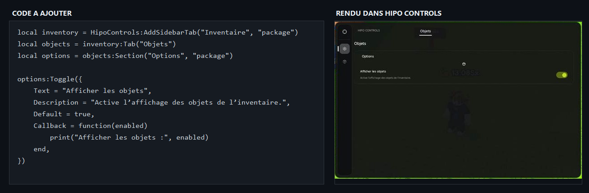

# HipoControls — guide Potassium

## Source et lancement

La source unique est [`HipoControlsBase/HipoControlsBase.lua`](HipoControlsBase/HipoControlsBase.lua). Elle retourne une bibliothèque; elle ne crée pas l’interface avant l’appel à `HipoControls.new(options)`.

Dans ton script client, charge la source puis crée l’interface :

~~~lua
local HipoControls = loadstring(game:HttpGet(
    "https://raw.githubusercontent.com/Krito444/HipoUiSource/refs/heads/main/HipoControlsBase/HipoControlsBase.lua"
))()

local UI_CONFIG = {
    Title = "Mon interface",
    Keybind = Enum.KeyCode.RightControl,
}

local ui = HipoControls.new(UI_CONFIG)
~~~

`ui` est l’instance de l’interface. Si une autre interface HipoControls est déjà ouverte, elle est fermée avant la création de la nouvelle.

## Configurer le titre et le raccourci

`UI_CONFIG` appartient au script appelant. Change `Title` et `Keybind` à cet endroit; le code de la bibliothèque reste identique.

~~~lua
local UI_CONFIG = {
    Title = "Bloxburg Helper",
    Keybind = Enum.KeyCode.RightControl,
}
~~~

`Keybind` définit le raccourci initial pour afficher ou masquer l’interface. Il reste modifiable pendant la session dans **Settings > General > Hide UI**. La taille de la fenêtre reste fixe.

## Organisation du menu

Un onglet latéral contient des pages. Chaque page contient des sections, puis des contrôles. Appelle `AddPage` sur l’instance `ui` :

~~~lua
local objects = ui:AddPage("Inventaire", "package", "Objets")
local options = objects:Section("Options", "package")

options:Toggle({
    Text = "Afficher les objets",
    Description = "Active l’affichage des objets de l’inventaire.",
    Default = true,
    Callback = function(enabled)
        print("Afficher les objets :", enabled)
    end,
})
~~~

L’image ci-dessous juxtapose le code et le rendu dans l’interface.

Chaque ligne prépare une partie du menu : `AddPage` crée le bouton latéral et la page, `:Section` regroupe les contrôles et `:Toggle` ajoute l’interrupteur. `Default` définit son état au démarrage. La fonction `Callback` reçoit `true` quand le toggle est activé et `false` quand il est désactivé.
À l’exécution, clique sur l’icône **Inventaire** dans la barre latérale pour afficher la page.

Pour ajouter plusieurs pages au même onglet latéral, réutilise le nom et l’icône sur la même instance `ui` :

~~~lua
local settings = ui:AddPage("Inventaire", "package", "Réglages")
local settingsSection = settings:Section("Affichage", "eye")
settingsSection:Dropdown({
    Text = "Trier par",
    Options = {"Nom", "Rareté"},
})
~~~

Les icônes utilisent les noms Lucide, par exemple `settings`, `eye`, `search` ou `package`.

## Contrôles disponibles

### Bouton

~~~lua
options:Button({
    Text = "Enregistrer",
    ButtonText = "Sauvegarder",
    Style = "filled",
    Callback = function()
        print("Enregistré")
    end,
})
~~~

Styles disponibles : `outline`, `filled`, `ghost` et `soft`. `Primary = true` sélectionne aussi le style rempli.

### Curseur

~~~lua
options:Slider({
    Text = "Distance",
    Min = 0,
    Max = 100,
    Step = 5,
    Default = 25,
    Suffix = " studs",
    Callback = function(value)
        print(value)
    end,
})
~~~

### Champ texte

~~~lua
options:Input({
    Text = "Nom",
    Placeholder = "Écris ici...",
    Default = "",
    Callback = function(value)
        print(value)
    end,
})
~~~

### Liste déroulante

~~~lua
options:Dropdown({
    Text = "Mode",
    Options = {"Simple", "Avancé", "Personnalisé"},
    Default = "Simple",
    Callback = function(choice)
        print(choice)
    end,
})
~~~

### Raccourci clavier

~~~lua
options:Keybind({
    Text = "Raccourci",
    Default = Enum.KeyCode.F,
    Callback = function(key)
        print("Touche pressée :", key.Name)
    end,
})
~~~

### Sélecteurs de couleur

~~~lua
options:ColorPicker({
    Text = "Couleur",
    Value = Color3.fromRGB(80, 170, 255),
    Callback = function(color)
        print(color)
    end,
})

options:Palette({
    Text = "Couleur rapide",
    Colors = {
        Color3.fromRGB(80, 170, 255),
        Color3.fromRGB(190, 220, 35),
        Color3.fromRGB(240, 90, 110),
    },
    Value = Color3.fromRGB(80, 170, 255),
    Callback = function(color)
        print(color)
    end,
})
~~~

## Options communes

| Option | Utilité |
|---|---|
| `Text` | Nom du contrôle. |
| `Description` | Texte explicatif facultatif. |
| `Default` | Valeur initiale pour les toggles, curseurs, champs, listes et raccourcis. |
| `Value` | Valeur initiale pour les sélecteurs de couleur. |
| `Callback` | Fonction appelée lors d’un changement ou d’une action. |
| `Icon` | Icône facultative du contrôle. |

Les contrôles avec une valeur renvoient un objet de contrôle. Garde-le dans une variable pour consulter ou modifier sa valeur avec `:Get()` et `:Set(...)`. Pour fermer l’interface et nettoyer ses connexions, appelle `ui:Destroy()`.
